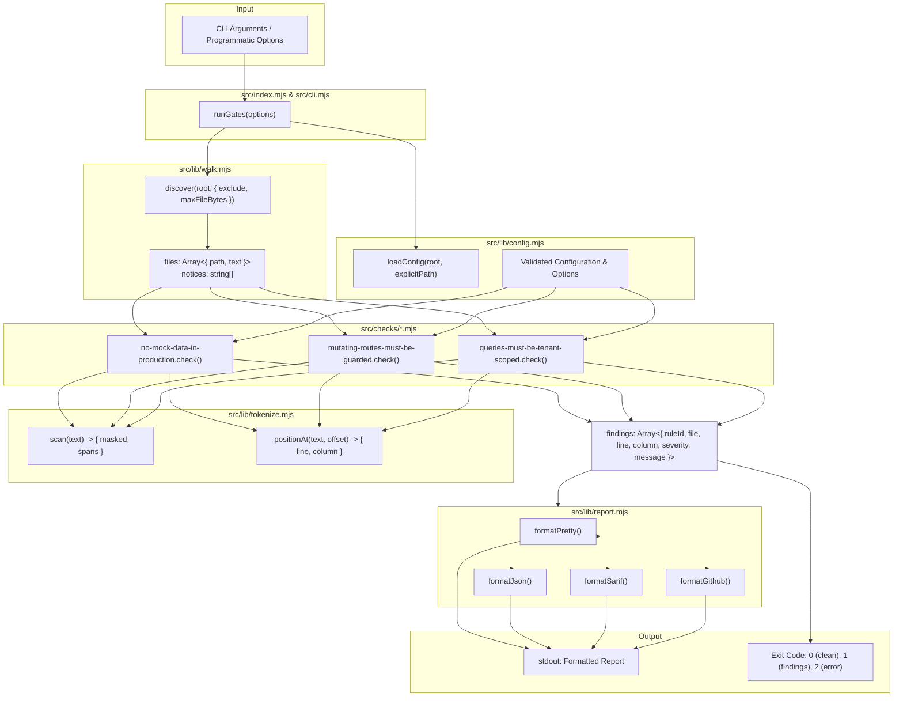

# System Architecture Overview

This document details the complete internal system architecture of `commerce-agent-gates`.

---

## 1. System Pipeline

---

## 2. Key Components

### 2.1 The Walker (`src/lib/walk.mjs`)

- Performs sorted recursive traversal starting at `root`.
- Filters ignored directories (`.git`, `.next`, `node_modules`, `dist`, `coverage`, `.turbo`, `.vercel`).
- Normalizes all paths to POSIX `/` separators.
- Canonicalizes directory paths to avoid symlink recursion loops.
- Enforces a 1 MiB size cap producing non-failing notices for skipped oversized files.
- Compiles glob-lite exclude expressions (`compileExclude`).

### 2.2 The Tokenizer (`src/lib/tokenize.mjs`)

- Single-pass offset-preserving lexical scanner.
- Classifies non-code into `comment`, `string`, and `regex` spans.
- Produces `masked` text where all non-code is blanked to spaces, preserving original length and all newlines.
- Maps any character offset back to 1-based `line` and `column` with `positionAt()`.
- Extracts balanced nested arguments with `balancedArgument()`.
- Detects inline directives via `lineHasInlineExemption()`.

### 2.3 Configuration Engine (`src/lib/config.mjs`)

- Resolves default options declared directly on each check (`meta.defaultOptions`).
- Reads `commerce-agent-gates.config.json` or `--config <path>`.
- Validates all keys with typo prevention.
- Validates typed values (strings, booleans, string arrays) and mandatory exemption reasons.

### 2.4 Reporting Engine (`src/lib/report.mjs`)

- Formats structured findings into:
  - `pretty`: High-contrast ANSI colored output for TTY terminals, with `NO_COLOR` support.
  - `json`: Machine-readable JSON object with tool version, summary tallies, notices, and findings.
  - `sarif`: SARIF 2.1.0 JSON format for GitHub Advanced Security code scanning.
  - `github`: GitHub Actions workflow commands (`::error file=...,line=...,col=...,title=...::message`).
