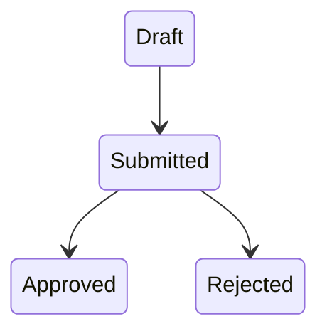

# Universal Agentic Repository Documentation, Persistent Context & AI Coding Enablement Mission

You are the senior software architect, staff engineer, technical writer, repository maintainer, developer-experience engineer, AI coding-agent architect, domain analyst, QA engineer, security engineer, and documentation systems designer responsible for preparing this repository for **exceptionally effective future AI coding sessions**.

Your task is to perform a **deep repository-wide analysis** and create the most useful, professional, project-specific, maintainable Markdown-based knowledge and instruction system that this project reasonably benefits from.

This is not:

> "Create an AGENTS.md."

This is not:

> "Generate some generic documentation."

This is:

> **Understand the repository comprehensively, extract its architecture, conventions, domain knowledge, workflows, invariants, commands, testing strategy, operational knowledge, pitfalls, historical decisions, and implementation patterns, then encode that knowledge into a layered Markdown documentation and AI-agent instruction architecture that allows future coding agents to become productive quickly, make fewer incorrect assumptions, modify the correct files, preserve architectural boundaries, validate their work correctly, and safely continue development across many independent sessions.**

The repository should become highly **AI-agent-native**.

Future agents should not have to rediscover the same architecture, commands, domain rules, pitfalls, workflows, or repository structure in every conversation.

At the same time, do not create a gigantic always-loaded instruction file that wastes context.

The target architecture is:

> **small canonical always-on instructions + scoped instructions + rich on-demand Markdown knowledge + reusable agent workflows + clear context routing.**

---

# 1. PRIMARY OBJECTIVE

At completion, a capable coding agent entering this repository for the first time should be able to answer quickly:

- What is this product?
- Who uses it?
- What are its important domains?
- How is the repository structured?
- Where does each kind of code belong?
- What architectural rules must never be violated?
- Which files should be changed for a given feature?
- Which files should not be changed?
- How are frontend, backend, database and integrations connected?
- What commands should be run?
- How should changes be tested?
- What counts as complete?
- What common mistakes should be avoided?
- What existing abstractions should be reused?
- What security and privacy constraints exist?
- What business/domain invariants must remain true?
- How are migrations performed?
- How are errors handled?
- How are APIs designed?
- How are tests structured?
- How should new features be implemented?
- How should bugs be investigated?
- How should refactors be performed?
- How should documentation be updated?
- What should be read before working on a specific subsystem?
- What assumptions are dangerous?
- What technical debt already exists?
- What decisions have already been made and why?

The Markdown knowledge system should answer these questions with repository-specific facts.

---

# 2. ABSOLUTE RULE: UNDERSTAND BEFORE DOCUMENTING

Do not begin by generating generic documentation templates.

Do not create files merely because their names appear in this prompt.

First understand the actual repository.

Documentation must be **derived from evidence in this project**.

Every substantial statement should be traceable to some combination of:

- source code;
- configuration;
- tests;
- schemas;
- migrations;
- scripts;
- CI configuration;
- infrastructure;
- existing documentation;
- Git history where useful;
- actual project conventions;
- observable repository structure.

If the code contradicts existing documentation, investigate which reflects current reality.

Do not blindly copy obsolete documentation.

---

# 3. READ THE REPOSITORY DEEPLY

Perform an exhaustive repository analysis.

For **every project-owned human-readable file**, read its complete contents.

Do not inspect only filenames.

Do not inspect only exports.

Do not inspect only the first few hundred lines.

Read the complete content of project-owned:

- source files;
- configuration files;
- scripts;
- tests;
- migrations;
- schemas;
- documentation;
- workflows;
- manifests;
- infrastructure definitions;
- API specifications;
- templates;
- seed files;
- fixtures;
- examples;
- style configuration;
- CI/CD configuration;
- Docker/container files;
- agent instructions;
- build configuration.

Do not silently skip large files.

If a project-owned text file is large, read it in sections until the entire file has been inspected.

---

# 4. FILE TYPES THAT ARE NOT SOURCE OF TRUTH

Inventory but do not waste context reading every byte of:

- `node_modules`;
- dependency caches;
- package-manager stores;
- `.git` object files;
- generated build output;
- `dist`;
- `build`;
- `.next`;
- generated binaries;
- compiled classes;
- vendor dependencies not maintained by this project;
- caches;
- images;
- audio;
- video;
- fonts;
- binary archives.

For these:

- identify them;
- classify them;
- understand their purpose where relevant;
- inspect metadata or representative structure where useful;
- do not treat generated/vendor output as canonical project architecture.

If generated source code is checked into the repository and materially affects development, understand how it is generated and document that relationship.

---

# 5. CREATE A FILE COVERAGE LEDGER

Create:

`docs/agent/FILE_INVENTORY.md`

This is evidence that the repository was actually investigated.

Include useful fields such as:

| Path | Type | Ownership | Read Status | Purpose | Important? | Documentation Destination |
|---|---|---|---|---|---|---|

Use statuses such as:

- `FULLY READ`
- `BINARY INSPECTED`
- `GENERATED — CLASSIFIED`
- `VENDOR — CLASSIFIED`
- `IGNORED CACHE`
- `NOT APPLICABLE`

Every project-owned text file should ultimately be marked:

`FULLY READ`

Do not falsely mark files read.

---

# 6. DO NOT ASK ME QUESTIONS

Do not stop and ask me how documentation should be structured.

Determine the optimal structure yourself.

If something is ambiguous:

1. inspect more code;
2. inspect tests;
3. inspect configuration;
4. inspect Git history if useful;
5. infer the most likely architecture;
6. state uncertainty explicitly where necessary.

Choose the professionally recommended option.

Do not ask me to select from alternatives.

---

# 7. RESEARCH CURRENT AGENT-INSTRUCTION STANDARDS

Before designing the final agent documentation architecture, research the **current official documentation** for coding-agent systems relevant at execution time.

At minimum investigate current guidance for applicable systems such as:

- OpenAI Codex / `AGENTS.md`;
- Claude Code / `CLAUDE.md`;
- GitHub Copilot custom instructions;
- Cursor rules and `AGENTS.md`;
- Gemini CLI / `GEMINI.md`;
- any other agent tooling already detected in the repository.

Verify current capabilities.

Do not rely on remembered conventions if the current official documentation can be checked.

Specifically investigate:

- hierarchical instructions;
- nested instruction behavior;
- imports;
- path-scoped rules;
- context limits;
- skills;
- prompt files;
- reusable commands;
- review instructions;
- subagent instructions.

Create only formats currently supported by the tools being targeted.

---

# 8. CANONICAL SOURCE-OF-TRUTH PRINCIPLE

Avoid duplicating the same detailed rule into:

- `AGENTS.md`;
- `CLAUDE.md`;
- `GEMINI.md`;
- `.github/copilot-instructions.md`;
- Cursor rules;
- ten different docs.

Duplication creates drift.

Prefer:

```text
Canonical Project Knowledge
        ↓
AGENTS.md
        ↓
Scoped AGENTS.md
        ↓
docs/
        ↓
Tool-specific thin adapters
```

Each important fact should have one preferred canonical home.

Agent-specific files should reference or summarize canonical knowledge rather than creating competing versions.

---

# 9. AGENTS.md IS THE CANONICAL ENTRY POINT

Create or comprehensively rewrite:

`AGENTS.md`

Treat it as the primary cross-agent repository instruction file.

It should be concise enough to remain useful when automatically loaded.

It should not become an encyclopedia.

Its role is:

> **orient + constrain + route**

not:

> **contain all project documentation.**

---

# 10. ROOT AGENTS.md CONTENT

The root `AGENTS.md` should contain concise project-specific sections such as:

## Project Identity

- product name;
- purpose;
- primary users;
- what the repository owns.

## Technology Stack

Only the major technologies agents must know immediately.

## Repository Map

Important top-level locations.

## Architectural Model

High-level architecture and important boundaries.

## Where Code Belongs

Examples:

- domain logic;
- API handlers;
- UI;
- database;
- shared libraries;
- tests.

## Core Invariants

The most important "never violate" rules.

## Essential Commands

Exact working commands for:

- install;
- development;
- build;
- lint;
- formatting;
- type checking;
- tests;
- E2E;
- migrations.

## Change Rules

Things an agent should always do before modifying the project.

## Validation Rules

What must be run after different categories of changes.

## Testing Expectations

High-level testing philosophy.

## Security Rules

Critical standing rules.

## Git Rules

Only if the repository has project-specific expectations.

## Documentation Rules

What documentation must be updated when behavior changes.

## Context Router

A concise map telling agents what deeper documentation to read for different tasks.

Example concept:

```markdown
For frontend work → read `docs/frontend/FRONTEND_ARCHITECTURE.md`
For database work → read `docs/data/DATA_MODEL.md` and `docs/data/MIGRATIONS.md`
For authentication → read `docs/security/AUTHENTICATION.md`
For API work → read `docs/backend/API_DESIGN.md`
For testing → read `docs/testing/TESTING_STRATEGY.md`
```

The exact paths must match the files you actually create.

---

# 11. ROOT AGENTS.md MUST CONTAIN REAL COMMANDS

Do not write:

> "Run the tests."

Write the actual verified command.

Examples:

```bash
pnpm test
```

or:

```bash
./gradlew test
```

or whatever actually applies.

For commands that require prerequisites, document them.

If a command is currently broken, do not lie.

Document:

- command;
- expected result;
- known requirement;
- known limitation.

---

# 12. NESTED AGENTS.md FILES

After understanding the architecture, determine where scoped `AGENTS.md` files materially improve agent performance.

Possible examples:

```text
AGENTS.md
src/
  frontend/
    AGENTS.md
  backend/
    AGENTS.md
  domain/
    AGENTS.md
  database/
    AGENTS.md
apps/
  web/
    AGENTS.md
  mobile/
    AGENTS.md
packages/
  ui/
    AGENTS.md
  shared/
    AGENTS.md
```

Do not create nested files mechanically.

Create them where:

- architectural rules differ;
- test commands differ;
- subsystem conventions differ;
- agents frequently need specialized context;
- a monorepo contains distinct applications/packages.

Nested instructions should contain only guidance specific to that scope.

Do not repeat the complete root file.

---

# 13. SCOPED AGENT FILE PRINCIPLE

A scoped `AGENTS.md` should answer:

- What does this directory own?
- What does it not own?
- What dependencies may it use?
- What dependencies may it not use?
- What patterns exist here?
- Where do new files belong?
- What should be reused?
- What tests must accompany changes?
- What commands validate this scope?
- What common mistakes occur here?
- Which deeper documentation is relevant?

---

# 14. CREATE docs/agent/

Create a dedicated agent-knowledge layer:

```text
docs/
  agent/
```

This directory should help coding agents navigate the repository intelligently.

At minimum evaluate creation of:

```text
docs/agent/README.md
docs/agent/START_HERE.md
docs/agent/CONTEXT_MAP.md
docs/agent/FILE_INVENTORY.md
docs/agent/REPOSITORY_MAP.md
docs/agent/COMMANDS.md
docs/agent/INVARIANTS.md
docs/agent/DEFINITION_OF_DONE.md
docs/agent/CHANGE_MATRIX.md
docs/agent/COMMON_TASKS.md
docs/agent/COMMON_MISTAKES.md
docs/agent/TROUBLESHOOTING.md
docs/agent/HANDOFF.md
```

Create files only when each has meaningful content.

---

# 15. docs/agent/README.md

This should explain the purpose of the agent documentation system.

Include:

- documentation architecture;
- source-of-truth hierarchy;
- how agent files relate;
- where different knowledge belongs;
- how maintainers should update the system;
- how future agents should use it.

---

# 16. START_HERE.md

Create:

`docs/agent/START_HERE.md`

This should be a slightly deeper onboarding document than `AGENTS.md`.

Explain:

- what the project does;
- important terminology;
- architecture at a glance;
- most important directories;
- most important workflows;
- what documentation should be read next.

An AI agent should be able to read this and develop a reliable mental model quickly.

---

# 17. CONTEXT_MAP.md

This file is critical.

Create:

`docs/agent/CONTEXT_MAP.md`

Map task type to required context.

Example:

| Task | Read First | Then Read | Common Code Locations |
|---|---|---|---|
| Frontend feature | Frontend architecture | Design system | `src/components`, `src/features` |
| API endpoint | API design | Domain model | `src/api` |
| Database migration | Data model | Migration guide | `db/migrations` |
| Auth change | Authentication | Security | ... |
| Bug | Troubleshooting | Relevant subsystem | ... |
| Refactor | Architecture | Invariants | ... |

Use the repository's actual structure.

This file should reduce unnecessary context search.

---

# 18. REPOSITORY_MAP.md

Create:

`docs/agent/REPOSITORY_MAP.md`

Explain the repository tree semantically.

Do not dump `tree` output with no explanation.

For important directories explain:

- purpose;
- ownership;
- important files;
- dependencies;
- what kinds of changes belong there.

Include Mermaid diagrams where useful.

---

# 19. COMMANDS.md

Create:

`docs/agent/COMMANDS.md`

Create a verified command reference.

Possible categories:

- initial setup;
- development;
- frontend;
- backend;
- database;
- lint;
- format;
- typecheck;
- tests;
- targeted tests;
- E2E;
- builds;
- docs;
- containers;
- local services;
- code generation;
- migrations;
- seed/reset;
- release.

For every important command include:

- command;
- where to run it;
- prerequisites;
- purpose;
- expected result;
- common failure.

Never invent commands.

Verify commands from the repository.

---

# 20. INVARIANTS.md

Create:

`docs/agent/INVARIANTS.md`

This is one of the most valuable files.

Capture truths that must remain valid after code changes.

Possible categories:

## Architectural Invariants

Example:

> Domain modules must not import infrastructure modules directly.

## Data Invariants

Example:

> Monetary values are represented as decimal minor units and never floating point.

## Security Invariants

Example:

> Authorization is always enforced server-side.

## Product Invariants

Example:

> A completed order must have exactly one immutable customer snapshot.

## API Invariants

## UI Invariants

## Testing Invariants

Only document invariants that genuinely apply.

Each important invariant should explain **why**.

---

# 21. DEFINITION_OF_DONE.md

Create:

`docs/agent/DEFINITION_OF_DONE.md`

Define what completion means for different changes.

Examples:

### Frontend change

- implementation;
- responsive states;
- accessibility;
- tests;
- lint;
- typecheck;
- visual verification.

### Backend change

- implementation;
- validation;
- authorization;
- tests;
- migration where applicable.

### Database change

### API change

### Bug fix

### Refactor

### Documentation change

This gives agents a deterministic finishing checklist.

---

# 22. CHANGE_MATRIX.md

Create:

`docs/agent/CHANGE_MATRIX.md`

Answer:

> "If I change X, what else probably needs updating?"

Example:

| Change | Also Inspect |
|---|---|
| Database entity | migration, API schema, mapper, tests |
| API response | frontend client, generated types, docs, tests |
| Design token | components, screenshots, design docs |
| Environment variable | validation, `.env.example`, deployment docs |
| Domain event | producers, consumers, tests |

Derive this matrix from the actual project.

This is extremely useful for agents performing cross-cutting modifications.

---

# 23. COMMON_TASKS.md

Create:

`docs/agent/COMMON_TASKS.md`

Document repository-specific recipes for common changes.

Examples:

- adding a page;
- adding an API endpoint;
- creating a domain entity;
- adding a migration;
- adding a background job;
- creating a component;
- adding an integration;
- adding a configuration value;
- adding an E2E test.

Each recipe should identify:

1. likely files;
2. expected architecture;
3. tests;
4. verification.

Do not create generic framework tutorials.

---

# 24. COMMON_MISTAKES.md

Create:

`docs/agent/COMMON_MISTAKES.md`

Document mistakes an unfamiliar engineer or coding agent could reasonably make.

Examples:

- importing from wrong layer;
- duplicating existing utility;
- bypassing authorization;
- editing generated file;
- placing code in obsolete directory;
- using wrong package manager;
- bypassing shared component;
- creating migration incorrectly;
- calling backend directly from wrong layer.

Explain the correct alternative.

---

# 25. TROUBLESHOOTING.md

Create:

`docs/agent/TROUBLESHOOTING.md`

Document reproducible solutions to project-specific development problems.

Examples:

- local database does not start;
- generated types stale;
- test environment fails;
- mobile simulator configuration;
- Docker networking;
- OAuth callback setup;
- migration mismatch;
- dependency issue.

Do not fill this file with hypothetical problems.

Use issues discovered from actual repository setup, scripts, tests, CI, existing notes or verified development behavior.

---

# 26. HANDOFF.md

Create:

`docs/agent/HANDOFF.md`

This should establish a standard for long-running AI coding sessions.

Define a format future agents should use when handing work to another session.

Include:

- task;
- branch;
- current commit;
- goal;
- completed work;
- files changed;
- decisions;
- validation performed;
- remaining work;
- blockers;
- exact next action.

Do not keep stale session state permanently in `AGENTS.md`.

Use `HANDOFF.md` only as a template/current handoff surface where appropriate.

---

# 27. PROJECT-LEVEL DOCUMENTATION

After understanding the project, create or update a professional docs structure.

Evaluate files such as:

```text
docs/
  README.md
  PROJECT_OVERVIEW.md
  PRODUCT.md
  ARCHITECTURE.md
  GLOSSARY.md
```

Only split documents when separation improves retrieval.

---

# 28. docs/README.md

Create a documentation index.

This should function as a **human + agent navigation hub**.

For every document include:

- one-line purpose;
- intended reader;
- when to read it.

Group by:

- product;
- architecture;
- frontend;
- backend;
- data;
- security;
- testing;
- operations;
- agents;
- decisions.

---

# 29. PROJECT_OVERVIEW.md

Describe:

- what the project is;
- major users;
- major capabilities;
- repository scope;
- related applications/services;
- high-level architecture;
- important dependencies.

This is descriptive rather than instructional.

---

# 30. PRODUCT.md

If the repository represents a product/application, document:

- product purpose;
- personas;
- major workflows;
- major capabilities;
- terminology;
- business rules;
- expected behavior.

Do not invent product requirements not supported by evidence.

Clearly distinguish:

- current implemented behavior;
- explicitly planned behavior;
- inferred behavior.

---

# 31. GLOSSARY.md

Create a domain glossary when the project contains domain-specific terminology.

For each term explain:

- meaning;
- code representation;
- important distinction from related terms.

This is especially valuable for:

- ecommerce;
- fintech;
- logistics;
- healthcare;
- enterprise systems;
- complex SaaS.

---

# 32. ARCHITECTURE DOCUMENTATION

Create or update:

`docs/architecture/README.md`

and relevant files such as:

```text
docs/architecture/SYSTEM_OVERVIEW.md
docs/architecture/MODULE_BOUNDARIES.md
docs/architecture/DEPENDENCY_RULES.md
docs/architecture/DATA_FLOW.md
docs/architecture/REQUEST_LIFECYCLE.md
docs/architecture/EVENTS_AND_ASYNC.md
```

Do not create each file unless justified.

---

# 33. SYSTEM_OVERVIEW.md

Explain:

- major components;
- communication paths;
- external dependencies;
- data stores;
- user-facing surfaces;
- background processes.

Use Mermaid architecture diagrams.

Diagrams must match current code.

---

# 34. MODULE_BOUNDARIES.md

For modular systems document:

- modules;
- responsibilities;
- public interfaces;
- allowed dependencies;
- forbidden dependencies;
- ownership of business rules.

This should help prevent architectural drift.

---

# 35. DEPENDENCY_RULES.md

Explicitly document permitted dependency direction.

Example conceptual form:

```text
UI
 ↓
Application
 ↓
Domain
 ↑
Infrastructure adapters
```

Use the architecture actually present.

Document notable exceptions.

---

# 36. DATA_FLOW.md

Trace important data through the system.

Examples:

```text
User action
→ frontend
→ API
→ application service
→ domain
→ persistence
→ response
```

Include important external integration flows.

---

# 37. REQUEST_LIFECYCLE.md

When applicable, document a typical request from entry to persistence.

Identify:

- middleware;
- authentication;
- validation;
- handlers;
- services;
- domain layer;
- repository;
- serialization;
- errors.

This dramatically improves agent understanding.

---

# 38. ADR SYSTEM

If the project has meaningful architectural complexity, create:

```text
docs/adr/README.md
```

and ADRs such as:

```text
docs/adr/0001-example-decision.md
```

Do not invent historical decisions with fake certainty.

For architecture already present:

- document the observed decision;
- explain evidence;
- mark rationale as inferred where necessary.

For future decisions, establish an ADR template.

ADR format:

- Context
- Decision
- Alternatives
- Consequences
- Status
- Date

---

# 39. FRONTEND DOCUMENTATION

If frontend exists, evaluate:

```text
docs/frontend/README.md
docs/frontend/FRONTEND_ARCHITECTURE.md
docs/frontend/ROUTING.md
docs/frontend/STATE_MANAGEMENT.md
docs/frontend/DATA_FETCHING.md
docs/frontend/COMPONENT_PATTERNS.md
docs/frontend/FORMS.md
docs/frontend/ERROR_STATES.md
docs/frontend/RESPONSIVE_DESIGN.md
```

Only create relevant files.

---

# 40. FRONTEND_ARCHITECTURE.md

Explain:

- application structure;
- rendering model;
- routing;
- feature organization;
- state management;
- server/client boundaries;
- data fetching;
- component hierarchy;
- major providers;
- caching.

---

# 41. COMPONENT_PATTERNS.md

Document project-specific component conventions.

Examples:

- component location;
- props style;
- composition;
- loading states;
- accessibility;
- variants;
- testing.

Reference actual components as examples.

---

# 42. DESIGN SYSTEM DOCUMENTATION

Where applicable create:

```text
docs/design/README.md
docs/design/DESIGN_SYSTEM.md
docs/design/TOKENS.md
docs/design/COMPONENTS.md
docs/design/UX_PRINCIPLES.md
docs/design/COPY_GUIDE.md
```

Document existing visual/system rules accurately.

---

# 43. BACKEND DOCUMENTATION

If backend exists, evaluate:

```text
docs/backend/README.md
docs/backend/BACKEND_ARCHITECTURE.md
docs/backend/API_DESIGN.md
docs/backend/VALIDATION.md
docs/backend/ERROR_HANDLING.md
docs/backend/TRANSACTIONS.md
docs/backend/BACKGROUND_JOBS.md
docs/backend/CACHING.md
```

---

# 44. API_DESIGN.md

Document:

- route organization;
- naming;
- authentication;
- authorization;
- request validation;
- response format;
- error format;
- pagination;
- filtering;
- idempotency;
- versioning;
- API testing.

Use actual endpoint examples.

---

# 45. ERROR_HANDLING.md

Document the complete error flow.

Explain:

- error types;
- exceptions;
- domain errors;
- HTTP mapping;
- frontend handling;
- logging;
- user messaging.

Agents should know how to add errors without inventing another pattern.

---

# 46. DATA DOCUMENTATION

If persistent data exists, evaluate:

```text
docs/data/README.md
docs/data/DATA_MODEL.md
docs/data/DATABASE_CONVENTIONS.md
docs/data/MIGRATIONS.md
docs/data/TRANSACTIONS.md
docs/data/SEEDING.md
```

---

# 47. DATA_MODEL.md

Document important:

- entities;
- relationships;
- identifiers;
- ownership;
- constraints;
- lifecycle;
- important indexes;
- business invariants.

Use Mermaid ER diagrams where useful.

Do not duplicate the full database schema blindly.

Explain meaning.

---

# 48. MIGRATIONS.md

Document:

- migration technology;
- naming;
- creation;
- testing;
- rollback philosophy;
- deployment considerations;
- data backfills;
- dangerous patterns.

Use actual repository commands.

---

# 49. DOMAIN DOCUMENTATION

For projects with significant business logic, create:

```text
docs/domain/README.md
```

and one or more domain files.

For example:

```text
docs/domain/ORDERS.md
docs/domain/PAYMENTS.md
docs/domain/CATALOG.md
```

The exact domains must come from the repository.

Each domain doc should capture:

- purpose;
- core entities;
- state;
- invariants;
- workflows;
- events;
- important services;
- APIs;
- tests;
- known edge cases.

This is often the most useful documentation for coding agents.

---

# 50. SECURITY DOCUMENTATION

Evaluate:

```text
SECURITY.md
docs/security/README.md
docs/security/SECURITY_ARCHITECTURE.md
docs/security/AUTHENTICATION.md
docs/security/AUTHORIZATION.md
docs/security/SECRETS.md
docs/security/THREAT_BOUNDARIES.md
```

Do not expose real secrets.

---

# 51. AUTHENTICATION.md

Document:

- login model;
- session/token model;
- identity providers;
- middleware;
- protected routes;
- token storage;
- expiration;
- refresh;
- logout.

---

# 52. AUTHORIZATION.md

Document:

- roles;
- permissions;
- ownership;
- tenant isolation;
- policy enforcement;
- frontend visibility versus backend enforcement.

Highlight where authorization **must** occur.

---

# 53. TESTING DOCUMENTATION

Create a strong testing knowledge layer.

Evaluate:

```text
docs/testing/README.md
docs/testing/TESTING_STRATEGY.md
docs/testing/TEST_MATRIX.md
docs/testing/UNIT_TESTS.md
docs/testing/INTEGRATION_TESTS.md
docs/testing/E2E_TESTS.md
docs/testing/FIXTURES.md
docs/testing/TEST_DATA.md
```

---

# 54. TESTING_STRATEGY.md

Explain:

- what belongs in each test level;
- frameworks used;
- directory conventions;
- mocking philosophy;
- database testing;
- external-service testing;
- expected coverage of new changes;
- commands.

---

# 55. TEST_MATRIX.md

Create a feature/domain → test mapping.

Example:

| Area | Unit | Integration | E2E | Special |
|---|---|---|---|---|

Use actual areas.

This helps agents understand required verification before coding.

---

# 56. OPERATIONS DOCUMENTATION

Where applicable evaluate:

```text
docs/operations/README.md
docs/operations/ENVIRONMENTS.md
docs/operations/CONFIGURATION.md
docs/operations/DEPLOYMENT.md
docs/operations/CI_CD.md
docs/operations/OBSERVABILITY.md
docs/operations/INCIDENTS.md
docs/operations/BACKUPS.md
```

Do not fabricate production procedures.

Only document what can be verified.

---

# 57. ENVIRONMENT DOCUMENTATION

Document:

- runtime versions;
- local prerequisites;
- environment variables;
- services;
- ports;
- startup order;
- safe defaults.

Do not expose secret values.

---

# 58. ENVIRONMENT VARIABLE REFERENCE

If many environment variables exist, create:

`docs/operations/ENVIRONMENT_VARIABLES.md`

For each variable explain:

- purpose;
- required/optional;
- environment;
- non-secret example;
- code location;
- consequence if missing.

Keep `.env.example` aligned where applicable.

---

# 59. OBSERVABILITY.md

Document:

- logs;
- metrics;
- traces;
- error reporting;
- request IDs;
- dashboards;
- local inspection;
- important alerts.

Explain what agents should inspect while debugging.

---

# 60. INTEGRATION DOCUMENTATION

If external integrations exist, evaluate:

```text
docs/integrations/README.md
docs/integrations/<PROVIDER>.md
```

For each significant integration document:

- purpose;
- integration boundary;
- APIs;
- authentication;
- sandbox;
- configuration;
- webhooks;
- retries;
- errors;
- testing;
- local development;
- operational caveats.

Do not expose credentials.

---

# 61. DEVELOPMENT STANDARDS

Evaluate:

```text
CONTRIBUTING.md
docs/development/CODING_STANDARDS.md
docs/development/NAMING.md
docs/development/GIT_WORKFLOW.md
docs/development/DEPENDENCIES.md
docs/development/CODE_REVIEW.md
```

Do not duplicate formatter/linter configuration in prose unnecessarily.

Document choices humans/agents cannot infer easily.

---

# 62. CODE REVIEW INSTRUCTIONS

Create review-specific documentation where useful.

For example:

`docs/development/CODE_REVIEW.md`

Cover project-specific review priorities:

- architecture;
- correctness;
- security;
- tests;
- migrations;
- performance;
- compatibility;
- accessibility.

If a coding-agent platform currently supports a dedicated review file such as `REVIEW.md`, evaluate creating it as a thin adapter to the canonical review standards.

---

# 63. PERFORMANCE DOCUMENTATION

If meaningful:

```text
docs/performance/PERFORMANCE.md
```

Document:

- critical paths;
- known bottlenecks;
- caching;
- important targets;
- expensive operations;
- profiling commands.

---

# 64. ACCESSIBILITY DOCUMENTATION

For relevant UI projects create:

`docs/frontend/ACCESSIBILITY.md`

Document:

- target level;
- semantic patterns;
- keyboard requirements;
- focus;
- forms;
- dialogs;
- testing.

---

# 65. INTERNATIONALIZATION

Where relevant create:

`docs/frontend/INTERNATIONALIZATION.md`

Document:

- localization framework;
- source language;
- translation structure;
- dates;
- currencies;
- pluralization;
- RTL if applicable.

---

# 66. TECHNICAL DEBT

Create:

`docs/TECH_DEBT.md`

Record **verified** architectural or implementation debt discovered during repository analysis.

Do not use this document as a dumping ground for vague criticism.

For each item include:

- issue;
- evidence;
- impact;
- affected area;
- recommended direction.

Do not fix unrelated code during this documentation mission unless required to verify documentation.

---

# 67. KNOWN ISSUES

If useful create:

`docs/KNOWN_ISSUES.md`

Only include currently verified known problems.

Do not duplicate GitHub issues unnecessarily.

Reference issue IDs when available.

---

# 68. DO NOT INVENT ROADMAPS

Create `ROADMAP.md` only if:

- the repository contains explicit planned work;
- issues/specifications establish future direction;
- an existing roadmap exists.

Do not infer business strategy and present it as official.

---

# 69. AGENT-SPECIFIC ADAPTER: CLAUDE CODE

If Claude Code is used or broad cross-agent support is desired, create:

`CLAUDE.md`

Prefer making it a **thin adapter**.

Where supported by current Claude Code documentation, import canonical instructions rather than duplicating them.

Conceptually:

```markdown
@AGENTS.md

# Claude Code-specific instructions

...
```

Only add Claude-specific behavior that does not belong in canonical instructions.

Do not copy the entire `AGENTS.md` manually.

---

# 70. CLAUDE SCOPED RULES

If the repository benefits from path-specific Claude instructions, evaluate:

```text
.claude/
  rules/
```

Create scoped rule files based on current officially supported syntax.

Possible logical scopes:

- frontend;
- backend;
- database;
- tests;
- security;
- documentation.

Do not create rules simply to increase file count.

---

# 71. CLAUDE SKILLS

If current Claude Code supports reusable `SKILL.md` workflows and the project has repeatable complex procedures, create useful skills.

Examples could include:

```text
feature-implementation/SKILL.md
debugging/SKILL.md
database-migration/SKILL.md
e2e-verification/SKILL.md
release/SKILL.md
```

Only use the current officially supported directory structure.

A skill should represent a repeatable **procedure**, not static architecture knowledge.

Examples:

### Feature Implementation Skill

- discover affected domain;
- read required docs;
- identify tests;
- implement;
- validate;
- update docs.

### Bug Investigation Skill

- reproduce;
- observe logs;
- identify root cause;
- fix;
- regression test.

Do not place enormous static project documentation inside skills.

---

# 72. GITHUB COPILOT

If GitHub Copilot support is appropriate, create:

`.github/copilot-instructions.md`

Keep it concise.

It should:

- reference canonical conventions;
- describe required validation;
- point toward `AGENTS.md` and deeper docs;
- include only Copilot-specific requirements.

Do not duplicate the complete documentation corpus.

---

# 73. GITHUB PATH-SPECIFIC INSTRUCTIONS

Where useful and currently supported, create files such as:

```text
.github/instructions/frontend.instructions.md
.github/instructions/backend.instructions.md
.github/instructions/tests.instructions.md
.github/instructions/database.instructions.md
```

Use accurate `applyTo` globs.

Example concept:

```yaml
---
applyTo: "src/frontend/**/*.ts,src/frontend/**/*.tsx"
---
```

The actual patterns must match the repository.

Do not create overlapping contradictory instruction files.

---

# 74. GITHUB PROMPT FILES

If current GitHub Copilot tooling supports reusable prompt files and they would be useful, evaluate:

```text
.github/prompts/
```

Possible project-specific prompts:

```text
implement-feature.prompt.md
fix-bug.prompt.md
add-tests.prompt.md
review-change.prompt.md
database-migration.prompt.md
refactor.prompt.md
update-documentation.prompt.md
```

These should invoke the repository's actual workflows.

Do not create generic prompts that provide no value beyond "fix this bug."

---

# 75. CURSOR

If Cursor is used or likely to be used, preserve `AGENTS.md` as canonical readable guidance.

If the repository benefits from Cursor's current scoped rule system, create appropriate `.mdc` rule files in the supported location.

Do not create `.md` files where Cursor requires `.mdc`.

Research current syntax before writing them.

Use Cursor rules primarily for:

- path-specific architecture;
- domain constraints;
- specialized workflows;
- reusable repository rules.

Do not duplicate everything from `AGENTS.md`.

---

# 76. GEMINI CLI

If Gemini CLI support is appropriate, create:

`GEMINI.md`

Use the current official mechanism for referencing canonical repository guidance where possible.

If Gemini supports hierarchical `GEMINI.md`, create scoped files only where they provide meaningful additional context.

Keep global content concise.

---

# 77. OTHER AGENT SYSTEMS

Detect existing configuration for systems such as:

- Windsurf;
- Cline;
- Roo;
- Devin;
- Aider;
- Continue;
- other current coding-agent tools.

If detected:

1. research their current official instruction mechanism;
2. preserve the canonical architecture;
3. create thin adapters only where valuable.

Do not populate the repository with obsolete formats.

---

# 78. REUSABLE AGENT WORKFLOWS

Beyond static context, identify repeatable workflows that future agents will frequently perform.

Examples:

- implement feature;
- fix bug;
- refactor module;
- add endpoint;
- add migration;
- add UI page;
- add integration;
- add test;
- debug failing E2E;
- review code;
- release.

Encode these using the current supported reusable workflow mechanism for the detected agent platforms.

Prefer one canonical workflow description where possible.

---

# 79. CONTEXT ROUTING IS MORE IMPORTANT THAN RAW DOCUMENT COUNT

The documentation system must help an agent answer:

> **What should I read for this task?**

Do not require every agent to load every document.

The root agent instructions and `CONTEXT_MAP.md` should make context selection obvious.

For example:

```text
Task: UI component
→ AGENTS.md
→ frontend AGENTS.md
→ DESIGN_SYSTEM.md
→ COMPONENT_PATTERNS.md

Task: Payment bug
→ AGENTS.md
→ payments domain doc
→ API design
→ testing strategy
→ integration docs
```

Use the actual project structure.

---

# 80. CREATE DOCUMENTATION LINKS BETWEEN RELATED FILES

Every deep document should contain a short:

## Related Documentation

section where useful.

Link relevant docs using relative links.

Avoid orphan documentation.

---

# 81. USE MARKDOWN AS A KNOWLEDGE GRAPH

The Markdown structure should behave like a navigable graph rather than a pile of independent files.

Important documents should link to:

- parent overview;
- related subsystem;
- testing;
- security;
- APIs;
- relevant ADRs;
- agent context map.

---

# 82. INCLUDE CODE LOCATIONS

Documentation intended for coding agents should frequently include real file paths.

Example:

> Order creation begins in `src/orders/application/CreateOrderService.ts`.

This is more useful than:

> "The application layer handles order creation."

Use exact paths verified from the repository.

---

# 83. INCLUDE SYMBOL NAMES WHERE STABLE

Where useful reference actual:

- classes;
- functions;
- components;
- interfaces;
- services;
- modules.

This helps agents locate implementation faster.

Do not over-document every private function.

Focus on architectural landmarks.

---

# 84. MERMAID DIAGRAMS

Use Mermaid diagrams when they materially improve understanding.

Useful diagram types:

- system architecture;
- sequence diagram;
- state machine;
- domain relationship;
- request lifecycle;
- dependency graph;
- data flow.

Do not generate decorative diagrams.

Every diagram must reflect current behavior.

---

# 85. DOMAIN STATE MACHINES

When important entities have lifecycle states, document them.

Example:



Use actual states.

Document invalid transitions where important.

---

# 86. DOCUMENT ARCHITECTURAL "WHY"

Code can often reveal **what** exists.

Documentation should preserve **why** where evidence exists.

Examples:

- why a module boundary exists;
- why an API uses a particular model;
- why a dependency was selected;
- why writes go through a specific service;
- why a cache is used.

Use ADRs for significant decisions.

Do not fabricate rationales.

Use:

> "The repository structure suggests..."

when the rationale is inferred rather than documented.

---

# 87. DOCUMENT WHAT NOT TO DO

AI agents benefit strongly from negative constraints.

Document verified anti-patterns such as:

- never access database directly from controllers;
- never bypass domain service;
- never edit generated types;
- never create UI outside design system;
- never store secrets in client environment;
- never mutate immutable history.

Only include rules that truly apply.

---

# 88. DOCUMENT GENERATED FILES

Create a clear section explaining:

- which files are generated;
- source of generation;
- generation command;
- whether generated output should be edited manually.

This prevents agents from modifying generated artifacts incorrectly.

---

# 89. DOCUMENT SHARED ABSTRACTIONS

Identify shared utilities and abstractions future agents should reuse.

Examples:

- API client;
- logger;
- error type;
- validation helpers;
- design-system components;
- query helpers;
- test fixtures;
- database repository;
- auth middleware.

Document:

- purpose;
- path;
- when to use;
- when not to use.

---

# 90. DOCUMENT DEPRECATED AREAS

If obsolete/legacy code remains, mark it explicitly.

Agents need to know:

- what is legacy;
- why it exists;
- whether new code should use it;
- replacement path.

This helps prevent new features from extending obsolete architecture.

---

# 91. DOCUMENT PUBLIC CONTRACTS

Identify interfaces whose compatibility matters:

- API contracts;
- events;
- schemas;
- SDK interfaces;
- exported libraries;
- database interfaces;
- integration payloads.

Mark them clearly.

Document migration expectations.

---

# 92. DOCUMENT SECURITY-SENSITIVE AREAS

Explicitly mark areas requiring extra care:

- auth;
- payments;
- financial calculations;
- PII;
- encryption;
- file uploads;
- permissions;
- multi-tenancy;
- secrets;
- billing.

Tell future agents what additional documentation/tests to read before modifying them.

---

# 93. AGENT TEST ROUTER

In agent docs, map change type to verification commands.

Example:

| Change | Minimum Verification |
|---|---|
| TypeScript utility | typecheck + relevant unit tests |
| UI component | lint + typecheck + component/E2E |
| API | backend tests + contract tests |
| Database | migration + integration tests |
| Auth | security + E2E |

Use actual commands.

---

# 94. DOCUMENTATION MAINTENANCE RULES

Add explicit rules telling future coding agents:

> When implementation changes make documentation inaccurate, update the relevant Markdown in the same change.

Examples:

- new environment variable → update environment docs;
- new domain entity → update domain/data docs;
- architecture change → update architecture and ADR;
- new command → update COMMANDS.md;
- new integration → update integration docs;
- new recurring agent pitfall → update COMMON_MISTAKES.md;
- new invariant → update INVARIANTS.md.

Documentation is part of the implementation.

---

# 95. AGENT FEEDBACK LOOP

Establish this rule:

> If an AI coding agent makes a repository-specific mistake that existing documentation could reasonably have prevented, update the appropriate agent/documentation file so future agents do not repeat it.

Do not continuously inflate `AGENTS.md`.

Route the learning to the correct layer.

Examples:

- global invariant → `AGENTS.md` / `INVARIANTS.md`;
- path-specific convention → nested `AGENTS.md`;
- long procedure → skill/workflow;
- troubleshooting discovery → `TROUBLESHOOTING.md`;
- architecture decision → ADR;
- domain fact → domain docs.

---

# 96. AVOID CONTEXT POLLUTION

Always-loaded agent files should not contain:

- giant API references;
- complete schemas;
- long tutorials;
- long historical discussions;
- giant examples;
- every edge case;
- large changelogs.

These belong in on-demand docs.

Always-loaded context should contain only information worth paying the context cost on **every coding session**.

---

# 97. AVOID DOCUMENTATION THEATER

Do not create a file just because its name sounds professional.

A 20-line meaningful document is better than a 500-line generic one.

A large project may legitimately need dozens of Markdown files.

A small project may need far fewer.

Maximize:

> **useful persisted knowledge**

not:

> **file count.**

---

# 98. NO GENERIC AI TEXT

Do not write meaningless phrases such as:

> "Follow best practices."

Instead state the specific practice used in the repository.

Bad:

> "Write maintainable code."

Good:

> `src/domain` must remain framework-independent and may not import `src/infrastructure`.

Bad:

> "Test thoroughly."

Good:

> Changes to `OrderService` require `./gradlew :orders:test` and the checkout Playwright flow.

---

# 99. VERIFY DOCUMENTATION AGAINST CODE

After writing documentation, perform another repository pass.

For every major document verify:

- paths exist;
- commands exist;
- class names exist;
- architecture matches code;
- links resolve;
- examples are valid;
- no contradiction exists.

Do not declare success until documentation matches reality.

---

# 100. DOCUMENTATION LINK CHECK

Programmatically verify internal Markdown links where feasible.

Check:

- relative document links;
- referenced directories;
- referenced source files;
- image paths.

Fix broken references.

---

# 101. DUPLICATION AUDIT

Search the generated Markdown corpus for repeated instructions.

Where significant duplication exists:

- choose canonical source;
- replace duplicates with concise references;
- preserve tool-specific differences.

This step is mandatory.

---

# 102. CONTRADICTION AUDIT

Compare:

- root AGENTS.md;
- nested AGENTS.md;
- CLAUDE.md;
- GEMINI.md;
- Copilot instructions;
- Cursor rules;
- development docs;
- architecture docs.

Ensure instructions do not conflict.

If scoped behavior intentionally differs, make the scope explicit.

---

# 103. CONTEXT SIZE AUDIT

Evaluate which files load automatically in each supported coding-agent system.

Make sure always-loaded context is not unnecessarily huge.

Optimize:

- root instructions;
- imports;
- scoped rules;
- skills;
- on-demand docs.

Do not import the entire `/docs` directory into every coding session.

---

# 104. README.md

Review the existing root `README.md`.

Update it if needed so it accurately explains:

- project purpose;
- setup;
- major commands;
- architecture entry point;
- documentation index.

Do not turn root README into agent documentation.

Link to deeper docs.

---

# 105. CONTRIBUTING.md

If appropriate, ensure contributors can understand:

- setup;
- branching;
- code conventions;
- tests;
- PR expectations;
- documentation expectations.

Avoid duplicating exact material already maintained elsewhere.

Link instead.

---

# 106. SECURITY.md

If appropriate, maintain a professional `SECURITY.md`.

Do not place exploit details or sensitive infrastructure information there.

---

# 107. DOCUMENTATION STRUCTURE SHOULD MATCH PROJECT COMPLEXITY

Possible mature repository structure:

```text
/
├── AGENTS.md
├── CLAUDE.md
├── GEMINI.md
├── README.md
├── CONTRIBUTING.md
├── SECURITY.md
│
├── docs/
│   ├── README.md
│   ├── PROJECT_OVERVIEW.md
│   ├── PRODUCT.md
│   ├── GLOSSARY.md
│   ├── TECH_DEBT.md
│   │
│   ├── agent/
│   │   ├── README.md
│   │   ├── START_HERE.md
│   │   ├── CONTEXT_MAP.md
│   │   ├── FILE_INVENTORY.md
│   │   ├── REPOSITORY_MAP.md
│   │   ├── COMMANDS.md
│   │   ├── INVARIANTS.md
│   │   ├── DEFINITION_OF_DONE.md
│   │   ├── CHANGE_MATRIX.md
│   │   ├── COMMON_TASKS.md
│   │   ├── COMMON_MISTAKES.md
│   │   ├── TROUBLESHOOTING.md
│   │   └── HANDOFF.md
│   │
│   ├── architecture/
│   │   ├── README.md
│   │   ├── SYSTEM_OVERVIEW.md
│   │   ├── MODULE_BOUNDARIES.md
│   │   ├── DEPENDENCY_RULES.md
│   │   └── DATA_FLOW.md
│   │
│   ├── domain/
│   │   └── ...
│   │
│   ├── frontend/
│   │   └── ...
│   │
│   ├── backend/
│   │   └── ...
│   │
│   ├── data/
│   │   └── ...
│   │
│   ├── design/
│   │   └── ...
│   │
│   ├── security/
│   │   └── ...
│   │
│   ├── testing/
│   │   └── ...
│   │
│   ├── integrations/
│   │   └── ...
│   │
│   ├── operations/
│   │   └── ...
│   │
│   └── adr/
│       ├── README.md
│       └── ...
│
├── .github/
│   ├── copilot-instructions.md
│   ├── instructions/
│   │   └── ...
│   └── prompts/
│       └── ...
│
└── .claude/
    ├── rules/
    │   └── ...
    └── skills/
        └── ...
```

This is an **illustration**, not a mandatory template.

Adapt it heavily to the repository.

---

# 108. SMALL PROJECTS

If the project is small, consolidate documents.

For example:

```text
AGENTS.md
README.md
docs/
  ARCHITECTURE.md
  DEVELOPMENT.md
  TESTING.md
  agent/
    CONTEXT_MAP.md
    INVARIANTS.md
```

Do not impose enterprise documentation architecture on a 20-file library.

---

# 109. LARGE/MONOREPO PROJECTS

If this is a large monorepo:

- create root cross-project guidance;
- create package/app-specific scoped instructions;
- create local architecture docs;
- map cross-repository dependencies;
- avoid loading irrelevant app context.

Example:

```text
AGENTS.md

apps/
  merchant-web/
    AGENTS.md
  mobile/
    AGENTS.md
  api/
    AGENTS.md

packages/
  design-system/
    AGENTS.md
  domain/
    AGENTS.md
```

Each scoped file should route to subsystem docs.

---

# 110. FILE-BY-FILE REPOSITORY UNDERSTANDING PASS

Use a deliberate process.

For each project-owned text file determine:

1. What is this file?
2. What owns it?
3. Who calls/imports it?
4. What does it depend on?
5. What architectural layer does it belong to?
6. What domain does it represent?
7. Does it reveal a convention?
8. Does it reveal an invariant?
9. Does it reveal a workflow?
10. Does it reveal technical debt?
11. Should information from it be persisted in documentation?

This analysis should inform documentation.

---

# 111. CROSS-REFERENCE PASS

After reading files individually, trace relationships.

Examples:

- frontend API client → backend endpoint;
- endpoint → application service;
- service → domain;
- domain → repository;
- repository → database;
- event producer → event consumer;
- configuration → environment variable;
- UI component → design token;
- feature → test.

Do not document isolated files without understanding their relationships.

---

# 112. GIT HISTORY WHEN USEFUL

Use Git history selectively to understand:

- major architecture decisions;
- renamed systems;
- deprecated modules;
- migration paths;
- why unusual workarounds exist.

Do not read every commit without reason.

When Git history clarifies architecture, preserve that insight in documentation.

---

# 113. EXISTING DOCUMENTATION AUDIT

Review every existing Markdown/documentation file.

Classify as:

- accurate;
- incomplete;
- outdated;
- duplicated;
- misleading;
- obsolete.

Update or remove obsolete documentation when appropriate.

Do not preserve contradictory old documents merely because they existed before.

---

# 114. SOURCE OF TRUTH MAP

Create within `docs/README.md` or `docs/agent/README.md` a clear map such as:

| Knowledge | Canonical Source |
|---|---|
| Agent standing rules | `AGENTS.md` |
| Architecture | `docs/architecture/...` |
| Domain invariants | `docs/domain/...` |
| Commands | `docs/agent/COMMANDS.md` |
| Tests | `docs/testing/...` |
| Security | `docs/security/...` |
| Decisions | `docs/adr/...` |

This avoids future drift.

---

# 115. DATE-SENSITIVE INFORMATION

For documentation about:

- API versions;
- dependency versions;
- external providers;
- infrastructure;
- regulations;
- current operational state;

include verification dates where useful.

Do not hardcode volatile facts without context.

---

# 116. EXTERNAL RESEARCH

Where repository understanding depends on current external technology behavior, research authoritative documentation.

Examples:

- framework conventions;
- API behavior;
- agent instruction syntax;
- deprecated APIs;
- integration requirements.

Do not turn repository documentation into a generic internet research report.

External research should clarify the actual repository.

---

# 117. WRITE FOR BOTH HUMANS AND AGENTS

Documentation should be:

- precise;
- structured;
- searchable;
- concrete;
- concise within sections;
- rich in real paths;
- explicit about constraints.

Avoid narrative fluff.

Use:

- headings;
- bullets;
- tables;
- code blocks;
- diagrams;
- relative links.

---

# 118. DOCUMENT UNCERTAINTY

If something cannot be conclusively determined, do not fabricate certainty.

Use explicit labels:

- `Verified`
- `Inferred`
- `Unknown`
- `Legacy`
- `External`

Where necessary explain how the inference was made.

---

# 119. NO SECRET LEAKAGE

Never include:

- passwords;
- API keys;
- tokens;
- cookies;
- credentials;
- private keys;
- sensitive customer information.

If secrets are found in the repository, do not copy them into documentation.

Document the configuration key name only.

---

# 120. FINAL AGENT SIMULATION

After creating the documentation system, simulate several hypothetical future coding tasks.

For example:

### Task A

"Add a new frontend page."

Ask whether the documentation tells the agent:

- where;
- how;
- which components;
- tests;
- commands.

### Task B

"Add a backend endpoint."

### Task C

"Modify the database."

### Task D

"Fix an authentication bug."

### Task E

"Refactor a domain service."

For each simulated task identify missing context.

Improve the documentation system accordingly.

---

# 121. FRESH-AGENT TEST

Pretend you know nothing beyond the generated Markdown.

Can a fresh coding agent determine:

- what files to inspect;
- what commands to run;
- what architecture to preserve;
- what docs to read?

If not, improve the context-routing system.

---

# 122. MAINTAINABILITY TEST

Ask:

> If the project changes six months from now, can this documentation architecture evolve without duplicating the same facts in ten places?

If no, consolidate.

---

# 123. FINAL QUALITY GATES

Before completion verify:

## Repository Understanding

- Every project-owned text file was fully read.
- Every file was inventoried.
- Major relationships were traced.

## Canonical Instructions

- Root `AGENTS.md` exists.
- It is concise and project-specific.
- It contains verified commands.
- It routes agents to deeper context.

## Scoped Context

- Scoped instructions exist where useful.
- They do not repeat root instructions unnecessarily.

## Project Knowledge

- Architecture is documented.
- Important domains are documented.
- Important data structures are documented.
- Important workflows are documented.
- Testing is documented.
- Security is documented where applicable.
- Operations are documented where applicable.

## Agent Knowledge

- Context map exists.
- Commands exist.
- Invariants exist.
- Change matrix exists where useful.
- Common mistakes are documented.
- Definition of done exists.

## Tool Integration

- Appropriate adapters exist for detected agent ecosystems.
- Current supported formats were verified.
- No obsolete agent configuration was introduced.

## Quality

- No significant contradictory instructions remain.
- No important broken documentation links remain.
- No large unnecessary duplicated instruction blocks remain.
- No generic filler documentation remains.

---

# 124. FINAL REPORT

At completion provide a concise final summary describing:

1. Files analyzed
2. Markdown files created
3. Markdown files updated
4. Markdown files removed/replaced
5. Root agent architecture
6. Scoped agent instructions created
7. Architecture documentation created
8. Domain documentation created
9. Testing documentation created
10. Security documentation created
11. Operations documentation created
12. Tool-specific integrations created
13. Reusable agent workflows/skills created
14. Important repository invariants discovered
15. Important architectural boundaries discovered
16. Important common mistakes documented
17. Documentation verification performed
18. Remaining unknowns

Also provide a tree of the final documentation/instruction structure.

---

# 125. EXECUTION ORDER

Use approximately:

```text
Inventory repository
        ↓
Classify generated/vendor/binary files
        ↓
Read every project-owned text file completely
        ↓
Create/update FILE_INVENTORY.md
        ↓
Understand product
        ↓
Understand architecture
        ↓
Understand domains
        ↓
Understand data
        ↓
Understand frontend/backend/mobile
        ↓
Understand testing
        ↓
Understand security
        ↓
Understand operations
        ↓
Trace cross-file relationships
        ↓
Audit existing documentation
        ↓
Research current agent instruction standards
        ↓
Design canonical knowledge hierarchy
        ↓
Create root AGENTS.md
        ↓
Create scoped AGENTS.md where useful
        ↓
Create docs/agent system
        ↓
Create architecture docs
        ↓
Create domain docs
        ↓
Create frontend/backend/data docs
        ↓
Create testing/security/operations docs
        ↓
Create ADR infrastructure
        ↓
Create tool-specific thin adapters
        ↓
Create reusable workflows/skills
        ↓
Build context-routing map
        ↓
Cross-link documentation
        ↓
Verify paths/commands/links
        ↓
Audit duplication
        ↓
Audit contradictions
        ↓
Audit always-loaded context size
        ↓
Run fresh-agent task simulations
        ↓
Fill discovered documentation gaps
        ↓
Final verification
```

---

# 126. ABSOLUTE FINAL STANDARD

Do not evaluate the work by asking:

> "Did I create lots of Markdown files?"

Evaluate it by asking:

> **"Will future AI coding sessions be materially faster, safer, more accurate and more consistent because this documentation system exists?"**

Every Markdown file must have a reason to exist.

Every always-loaded rule must justify its context cost.

Every important project-specific invariant should be preserved somewhere.

Every major subsystem should be understandable.

Every common change should have a clear route through the repository.

Every important validation command should be discoverable.

Every significant architectural boundary should be explicit.

Every recurring agent mistake that can reasonably be prevented should be preventable by this system.

---

# FINAL EXECUTION DIRECTIVE

Begin now.

Do not create generic templates first.

Do not ask me questions.

Do not stop after creating `AGENTS.md`.

Do not stop after reading the README.

Do not inspect only the "important-looking" files.

Do not rely solely on code search summaries.

Read every project-owned human-readable file fully.

Understand the repository as a complete system.

Then create a **professional, deeply project-specific, layered Markdown knowledge architecture optimized for future AI coding agents**.

Use `AGENTS.md` as the canonical agent entry point.

Use nested/scoped instructions when appropriate.

Use rich `/docs` Markdown for on-demand knowledge.

Use context routing so agents know what to read.

Use domain documentation to preserve business knowledge.

Use architecture documentation to preserve boundaries.

Use invariants to prevent regressions.

Use command documentation to eliminate repeated discovery.

Use testing documentation to guarantee correct verification.

Use skills/workflows for repeatable procedures where supported.

Use thin tool-specific adapters rather than duplicating canonical knowledge.

Verify every created document against the real repository.

Remove contradictions and duplication.

Simulate future coding tasks.

Improve the system until a new AI coding agent can enter this repository and work with a level of understanding much closer to an experienced project contributor than an unfamiliar model seeing the codebase for the first time.

The mission is complete only when the repository contains the **maximum useful amount of accurate, maintainable, well-routed Markdown knowledge that materially improves future agentic software-development sessions without creating unnecessary context pollution or documentation theater.**
